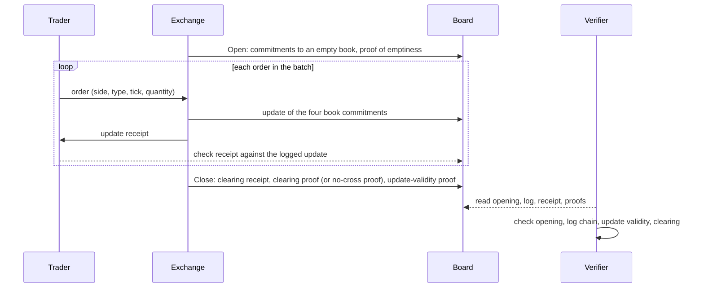
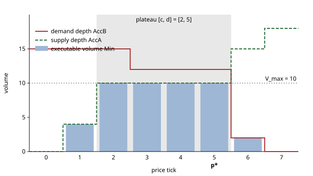

# 3 The zk-FBA Protocol

## 3.1 Overview

The exchange receives orders, maintains the book, and clears each batch. Traders check receipts for their own orders. Any party with access to the append-only public board can verify the batch outcome.

Figure 1 traces a batch from the empty book to public verification.

1. **Open.** The exchange publishes commitments to an empty book and a proof that it is empty.
2. **Collect.** For each order, the exchange updates the commitments, appends the change to the board, and returns an update receipt to the trader. The trader checks the receipt against the board.
3. **Close.** The exchange runs the clearing rule of Section 2.1 on the book. It publishes either a clearing receipt with a *clearing proof*, or a *no-cross proof* if no bid meets an ask. It also publishes an *update-validity proof* that every logged change is a valid order.
4. **Verify.** The verifier checks the opening, the chain of updates, and the two proofs against the final commitments.

**Figure 1.** Messages exchanged during a batch. Dashed arrows indicate reads from the public board.

**Public information.** The board records order counts and arrival times. For a crossing batch, the exchange also publishes $(V_{max},c,d,p^*,V_{min\Delta},s,P,J)$. The first three entries give the maximum executable volume and the endpoints of its plateau. The next three give the clearing tick, its imbalance, and the long side ($s=0$ for demand and $s=1$ for supply). $P$ is the long-side volume at exactly $p^*$, and $J$ is the eligible IO volume on the short side. A balanced batch uses $s=P=J=0$.

## 3.2 Encoding the Book

**Domain.** Let $\mathbb{F}$ be the scalar field of BN254 and $H = \{1, \omega, \ldots, \omega^{n-1}\} \subset \mathbb{F}$ a multiplicative subgroup, with $n$ a power of two. The book has $N \le n$ price ticks, and tick $i$ sits at $\omega^i$. Ticks $N, \ldots, n-1$ are padding. A *column* is a polynomial of degree below $n$ given by its values on $H$; we write $B[i]$ for $B(\omega^i)$. A constraint $F(X) = 0$ means that $F$ vanishes on $H$, that is, $Z_H(X) = X^n - 1$ divides $F$. $L_i(X)$ is the Lagrange polynomial that is 1 at $\omega^i$ and 0 on the rest of $H$.

**Orders.** We store ordinary bids $B$, ordinary asks $A$, IO bids $IOB$, and IO asks $IOA$ in four columns. An order of size $q$ at tick $i$ adds $q$ to one cell. We encode a market buy at tick $N-1$ and a market sell at tick 0, making each eligible across the grid.

**Widths.** We fix two bit widths at setup. Every entry of the book is below $2^{k_{in}}$, and every accumulated quantity is below $2^k$ with $k \ge k_{in} + \lceil \log_2 N \rceil$. We use $k_{in} = 32$ and $k = 42$ for $N = 1000$.

**Derived columns.** The exchange computes nine value columns from the four book columns. Table 1 lists these alongside the lookup witnesses and public polynomials. Figure 2 follows the calculation on eight ticks.

**Table 1.** Committed columns and public polynomials. For $n = 1024$ and $k_{in} = 32$ there are 88 columns.

| Column | Value at tick $i$ | Count |
|---|---|---|
| $B$, $A$, $IOB$, $IOA$ | The book | 4 |
| $AccB$, $IOAccB$ | Demand depth: sum of bids at ticks $\ge i$ | 2 |
| $AccA$, $IOAccA$ | Supply depth: sum of asks at ticks $\le i$ | 2 |
| $Min$ | Executable volume $\min(AccA[i], AccB[i])$ | 1 |
| $SurpB$, $SurpA$ | $AccB[i] - Min[i]$ and $AccA[i] - Min[i]$ | 2 |
| $\Delta$ | Imbalance $\lvert AccA[i] - AccB[i] \rvert$ | 1 |
| $Slack$ | Gap witnesses for strict inequalities | 1 |
| Limbs | 8-bit limbs of the nine range-checked quantities | 46 |
| $Mult$, $h_1, \ldots, h_{26}$, $U$, $S$ | Lookup columns (Section 3.4) | 29 |
| **Public polynomial** | **Definition** | |
| $Pad$ | $\sum_{i=N}^{n-1} L_i$ | |
| $Mask_P$ | $\sum_{i=c}^{d} L_i$, the plateau | |
| $Mask_C$ | $L_{c-1} + L_{d+1}$, omitting a term whose index leaves $[0, n-1]$ | |
| $Mask_T$ | $L_{p^*-1}$ if $p^* > c$ and ($s = 1$ or $V_{min\Delta} = 0$), else 0 | |
| $T$ | $\sum_{i < 256} i \cdot L_i$, the range table | |

The verifier derives the public polynomials from the parameters and receipt. They require no additional commitments.

**Figure 2.** Bids of 3, 10, and 2 units rest at ticks 2, 5, and 6. Asks of 4, 6, 5, and 3 rest at ticks 1, 2, 6, and 7, and a one-unit sell IO rests at tick 4. Volume reaches 10 at ticks 2 through 5. Demand exceeds supply by five units at tick 2 and by two at ticks 3 through 5. The tertiary rule selects tick 5, giving the receipt $(10,2,5,5,2,0,10,1)$.

## 3.3 Walkthrough of a Constraint

To constrain $Min[i]=\min(AccA[i],AccB[i])$ at every tick, we introduce two surpluses. Each is the difference between a depth and the proposed minimum.

$$SurpB(X) - \big(AccB(X) - Min(X)\big) = 0, \qquad SurpA(X) - \big(AccA(X) - Min(X)\big) = 0 \tag{F9, F10}$$

$$SurpA(X) \cdot SurpB(X) = 0 \tag{F11}$$

$$SurpB[i] \in [0, 2^k), \qquad SurpA[i] \in [0, 2^k) \quad \text{for all } i \tag{F12, F13}$$

F11 sets at least one surplus to zero, so $Min$ equals one of the depths. F12 and F13 bound both differences to $[0,2^k)$. Under the width bound in Appendix C.5, a negative difference maps to a field element above this range. At tick 3 in Figure 2, demand is 12 and supply is 10. The only possible witnesses are $Min=10$, $SurpB=2$, and $SurpA=0$.

F9 and F10 bind those differences to the book. Without them, both surplus witnesses could be zero regardless of the proposed minimum.

Because at least one surplus vanishes, their sum gives the absolute imbalance. The identity

$$\Delta(X) - \big(SurpA(X) + SurpB(X)\big) = 0 \tag{F18}$$

forces $\Delta[i] = \lvert AccA[i] - AccB[i] \rvert$.

## 3.4 Range Checks

Every inequality in the protocol is a range check, and we use one gadget for all of them. To prove $Y[i] \in [0, 2^b)$ for a column $Y$ at every tick, the prover commits to limb columns $\ell_0, \ldots, \ell_{m-1}$ with $m = \lceil b/8 \rceil$ and shows

$$Y(X) - \sum_{l=0}^{m-1} 2^{8l}\, \ell_l(X) = 0,$$

together with the claim that every limb value lies in the table $\{0, \ldots, 255\}$ (for a domain smaller than 256 we use narrower limbs). When $b$ is not a multiple of 8, the top limb must be below $2^r$ with $r = b \bmod 8$; this holds exactly when $2^{8-r}$ times the top limb is also in the table, so we look that value up as well. The range proved is exactly $[0, 2^b)$.

We prove table membership for all limbs of all nine quantities with one logarithmic-derivative lookup [26]. Let $f_1, \ldots, f_E$ be the looked-up columns and $T$ the table column. The prover commits to a multiplicity column $Mult$, where $Mult[v]$ counts the cells equal to $v$. After a challenge $\beta$, it commits to helper columns defined on $H$ by

$$h_j = \frac{1}{\beta - f_{2j-1}} + \frac{1}{\beta - f_{2j}}, \qquad U = \frac{Mult}{\beta - T}, \qquad S[i+1] = S[i] + \sum_j h_j[i] - U[i].$$

We constrain the helpers by the following identities.

$$h_j \,(\beta - f_{2j-1})(\beta - f_{2j}) - (\beta - f_{2j-1}) - (\beta - f_{2j}) = 0, \qquad U\,(\beta - T) - Mult = 0,$$

$$S(\omega X) - S(X) - \Big(\sum_j h_j(X) - U(X)\Big) = 0. \tag{F23}$$

The running sum wraps from $\omega^{n-1}$ to 1. Summing its differences over $H$ cancels every term of $S$, yielding

$$\sum_{i=0}^{n-1} \sum_{e=1}^{E} \frac{1}{\beta - f_e[i]} = \sum_{i=0}^{n-1} \frac{Mult[i]}{\beta - T[i]}.$$

As an identity of rational functions in $\beta$, this holds only if every $f_e[i]$ is a table value. The limbs and $Mult$ are committed before $\beta$ is drawn, so a prover with a cell outside the table passes with probability at most $(2E+2)\,n/|\mathbb{F}|$ (Appendix C.7). The running sum needs no initial condition, since only its differences are constrained.

A first version of the protocol committed to one column per bit, with a booleanity constraint on each [40]. For 32-bit volumes that is 351 columns. With limbs and the lookup we have 46 limb columns and 29 lookup columns, and the proof falls from 22.9 KB to 6.1 KB. The lookup costs a second prover round and raises the degree of the quotient from about $n$ to about $2n$.

## 3.5 Clearing Constraints

Table 2 groups the constraints by their role in clearing. Appendix B gives the full identities.

**Table 2.** The clearing constraints. A range check is a limb decomposition whose limbs enter the lookup F23.

| Group | Constraints | What they force |
|---|---|---|
| Book | F1, F2, F24, F25 (range); F3, F4, F26, F27 ($Pad \cdot B = 0$, and likewise) | Entries in $[0, 2^{k_{in}})$; padding ticks empty |
| Depth | F5–F8, F28–F31 | $AccB$, $IOAccB$ are suffix sums; $AccA$, $IOAccA$ are prefix sums |
| Executable volume | F9–F13 | $Min = \min(AccA, AccB)$ |
| Phase 1: plateau | F14 (range of $V_{max} - Min$); F15, F16 ($Min = V_{max}$ at $c$ and $d$); F17 (cliffs) | $V_{max}$ is the maximum of $Min$ and $[c,d]$ is exactly where it is attained |
| Phase 2: clearing tick | F18 ($\Delta$); F19 (range of $\Delta - V_{min\Delta}$ on the plateau); F20 (pins at $p^*$); F21 (tie-break); F22 (range of $Slack$) | $V_{min\Delta}$ is the minimum imbalance on the plateau, attained at $p^*$ on side $s$; no lower tick qualifies |
| Phase 3: rationing | F32, F33 (pins at $p^*$) | $P$ and $J$ are the at-price long volume and the eligible IO volume |
| Lookup | F23 | Every limb is in $\{0, \ldots, 255\}$ |

**Depth.** The two accumulators run in opposite directions:

$$L_{n-1}(X)\big(AccB(X) - B(X)\big) = 0, \qquad (X - \omega^{n-1})\big[AccB(X) - AccB(\omega X) - B(X)\big] = 0, \tag{F5, F7}$$

$$L_{0}(X)\big(AccA(X) - A(X)\big) = 0, \qquad (X - \omega^{n-1})\big[AccA(\omega X) - AccA(X) - A(\omega X)\big] = 0. \tag{F6, F8}$$

The factor $X-\omega^{n-1}$ disables both recurrences at the wraparound. Demand adds the current tick’s bids to demand at the next tick. Supply adds the next tick’s asks to supply at the current tick. The recurrences include padding rows, where F3 and F4 set the book entries to zero. A bid in a padding row would otherwise contribute to demand at every real price.

**Phase 1.** F14 gives $Min \le V_{max}$ everywhere, and F15 and F16 pin $Min = V_{max}$ at the two endpoints. The cliff constraint makes the ticks just outside strictly lower:

$$Mask_C(X) \cdot \big(V_{max} - Min(X) - 1 - Slack(X)\big) = 0, \tag{F17}$$

with $Slack \ge 0$ by F22. These four constraints pin the whole plateau, because $Min$ is the pointwise minimum of a non-increasing and a non-decreasing sequence: for $i < j < l$ we have $Min[j] \ge \min(Min[i], Min[l])$. Every tick between $c$ and $d$ therefore attains $V_{max}$, and a tick beyond a cliff that attained it would lift the cliff to $V_{max}$ as well. The executable volume at the cliffs stays hidden behind $Slack$; opening it would disclose depth that the receipt does not contain. $Mask_C$ drops a cliff that does not exist ($c = 0$ or $d = n-1$), so no index wraps around the domain.

**Phase 2.** F19 proves $\Delta \ge V_{min\Delta}$ on the plateau, and the two pins

$$L_{p^*}(X)\big(SurpB(X) - (1-s)\,V_{min\Delta}\big) = 0, \qquad L_{p^*}(X)\big(SurpA(X) - s\,V_{min\Delta}\big) = 0 \tag{F20}$$

show that the minimum is attained at $p^*$ and fix which side is long.

Ticks 3 through 5 in Figure 2 all minimize imbalance. At tick 3 the bids strictly above the clearing price would total 12 units, yet ordinary supply is only 10. To fill better-priced orders in full even when no IO orders arrive, we require long-side volume at the clearing tick to cover the entire initial imbalance, $V_{min\Delta}\le P$. This yields the tertiary rule.

> Among the plateau ticks with minimum imbalance, $p^*$ is the lowest one whose long-side volume at that tick covers the imbalance.

In Figure 2, only tick 5 has sufficient at-price volume ($P=10$ for an imbalance of 2). For a positive minimum imbalance, at most two ticks qualify, the highest demand-long minimizer and the lowest supply-long minimizer. At least one exists. When the imbalance is zero, every balanced plateau tick qualifies (Appendix A). The verifier checks $V_{min\Delta}\le P$ on the receipt. For a supply-long or balanced outcome above $c$, the following identity excludes a lower candidate.

$$Mask_T(X) \cdot \big(\Delta(X) - V_{min\Delta} - 1 - Slack(X)\big) = 0. \tag{F21}$$

The tick $p^* - 1$ lies inside the plateau and the cliffs lie outside it, so one $Slack$ column serves F17 and F21.

**Phase 3.** Two pins bind the remaining receipt values to the book, with $\nu = 1$ if $V_{min\Delta} > 0$ and 0 otherwise:

$$\nu\, L_{p^*}(X)\big((1-s)\,B(X) + s\,A(X) - P\big) = 0, \qquad \nu\, L_{p^*}(X)\big((1-s)\,IOAccA(X) + s\,IOAccB(X) - J\big) = 0. \tag{F32, F33}$$

From the receipt we compute admitted IO volume $I=\min(J,V_{min\Delta})$, residual imbalance $R=V_{min\Delta}-I$, and traded volume $V_{max}+I$. With positive imbalance, long-side volume at $p^*$ fills at $(P-R)/P$. Eligible short-side IO volume fills at $I/J$ when $J>0$. All other eligible ordinary volume fills in full. In Figure 2, one IO unit trades and one unit of demand remains unfilled. Bids at tick 5 fill at $9/10$, bringing total traded volume to 11. Traders can apply these ratios to their own orders before integer rounding.

**Scalar checks.** Before checking polynomial identities, the verifier requires $0\le c\le p^*\le d\le N-1$, $1\le V_{max}<2^k$, $s\in\{0,1\}$, $0\le V_{min\Delta}\le P<2^k$, and $0\le J<2^k$. A zero imbalance also requires $s=P=J=0$. The first check places the clearing tick inside the claimed plateau.

**Uniqueness.** A crossing book admits exactly one receipt. Theorem 1 in Appendix C shows that an accepted receipt satisfies the clearing rule. Theorem 2 constructs a witness for the receipt that the rule selects.

## 3.6 The No-Cross Statement

When no bid meets an ask, executable volume is zero at every tick. We prove this smaller statement separately. The exchange commits to $B$, $A$, $AccB$, $AccA$, and the limbs of $B$ and $A$. It proves F1–F8, table membership for those limbs, and

$$AccA(X) \cdot AccB(X) = 0.$$

Both depths are sums of range-checked entries, so they are non-negative, and the product vanishes at a tick exactly when $\min(AccA, AccB) = 0$ there. No receipt value is disclosed. Imbalance-only orders take no part, since they cannot create a cross.

## 3.7 From Constraints to a Proof

Following the PIOP construction [22], the prover commits to the witness in two rounds before committing to the quotient.

1. The prover commits to the value columns, the limb columns, and $Mult$. The book columns are already committed on the board (Section 4).
2. The verifier sends $\beta$. The prover commits to the lookup helpers.
3. The verifier sends $\alpha$. The prover combines all identities into $F(X) = \sum_t \alpha^t F_t(X)$, computes the quotient $Q(X) = F(X)/Z_H(X)$, and commits to it.
4. The verifier sends $\zeta$. The prover opens every column at $\zeta$, and the columns that appear shifted ($AccB$, $AccA$, $IOAccB$, $IOAccA$, $A$, $IOA$, $S$) at $\omega\zeta$ as well.
5. The verifier evaluates the public polynomials at $\zeta$, recomputes $F(\zeta)$ from the openings, and checks $F(\zeta) = Q(\zeta)\, Z_H(\zeta)$.

We commit with KZG10 [29] over BN254 in its hiding form, batch all openings at one point into one group element with a random linear combination, and verify both points with two pairings. We remove the verifier's messages with the Fiat–Shamir transform over a SHA-256 transcript that absorbs the parameters, the receipt, and every commitment. For zero knowledge, the prover adds to each column a random multiple of $Z_H$, which changes no value on $H$ and makes the openings at $\zeta$ and $\omega\zeta$ independent of the column.

The lookup pair identities are cubic in the columns. The remaining identities are at most quadratic. The quotient has degree about $2n$, and the implementation uses a reference string through degree $2n+8$. For $n=1024$ and 32-bit volumes, 88 column commitments, the quotient commitment, and their openings occupy 6,124 bytes. With a fixed column layout, the numbers of commitments and pairings stay fixed. Evaluating public selectors can still depend on the plateau width (Appendix D).
