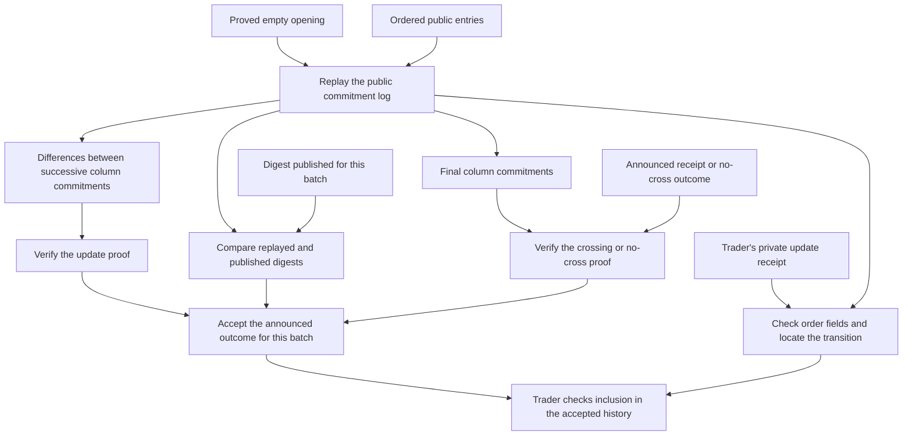

# 3. Proving the clearing result

We prove two statements at the close of a batch. The **clearing proof** establishes that applying the auction rule to the final book gives the announced outcome. The **update proof** establishes that the recorded changes to the book were bounded additions. Replaying one opening and log supplies the update differences and final column commitments. The exchange separately announces the outcome to be checked against them. A trader can then identify the change made for a particular order in the history whose outcome everyone verifies.

During collection the exchange receives orders privately. For each accepted order it returns a private update receipt and publishes four blinded commitments, one for each volume column. At close it publishes the update proof and either a public clearing receipt with its proof or a no-cross announcement with its proof. We describe the price calculation first. [Section 4](04-committed-book.md) explains how the verifier obtains its inputs from the log.

**Figure 1. Verification of one batch.** The crossing proof uses all four final column commitments. The no-cross proof uses the two ordinary columns. In both branches the update proof covers all four columns, and a trader can check their private receipt against the same history. The venue identifies the instrument, grid, cutoff and final log digest through a common publication channel.

## Public statement and encoding

For a crossing batch the prover must show knowledge of openings of the four final commitments to bounded volume arrays on which the rule returns exactly the eight announced fields of $R$. The arrays themselves remain private inputs. The verifier takes the commitments from the log and the receipt from the exchange. A proof for a different book would answer a different question, even if it gave the same price. Binding and the shared-commitment assumptions in [Section 5](05-security.md) tie the closing calculation to the recorded columns.

The public parameters include $N$, the padded domain size $n$, the entry width $k_{\rm in}$ and the accumulator width $k$. In our Rust implementation $n=\max(2,2^{\lceil\log_2N\rceil})$, $k=k_{\rm in}+\lceil\log_2N\rceil\leq62$. In the crossing relation, the *aggregate* at each real tick must fit in $k_{\rm in}$ bits for each of the four columns. In the no-cross relation this bound applies to the two ordinary columns. A bound on each incoming order alone would not imply that bound on their sum. With valid entries and zero padding, the total in any one column is below $2^k$.

The commitments bind each quantity to its position on the price grid. If the venue agrees on grid origin $p_0$ and spacing $h$, the corresponding monetary price is $p_0+hp^\star$. The clearing transcript in our Rust implementation absorbs the dimensions, widths, eight receipt fields and proof commitments. Instrument, currency, grid origin, tick spacing and wall-clock cutoff are external to that transcript. For public verification of a quoted price, the venue must associate those terms and one final log digest with the batch. Otherwise two observers can agree on the proof and interpret its tick as different prices.

Let $H=\{1,\omega,\ldots,\omega^{n-1}\}$ be a multiplicative subgroup of the BN254 scalar field $\mathbb{F}$. Tick $i$ occupies row $\omega^i$. Its Lagrange selector $L_i$ equals one on that row and zero on every other row of $H$. Each column has an interpolant of degree below $n$. Masking can increase its degree without changing any row. An identity need only vanish on $H$; equivalently, its polynomial is divisible by $Z_H(X)=X^n-1$. Comparing adjacent depths becomes a relation between evaluations at $X$ and $\omega X$. This arrangement lets the exchange aggregate orders at equal prices before proving the closing calculation.

## From the private book to a unique tick

The constraint labels refer to the relations in [Appendix B](B-constraint-relations.md). We first show what each group establishes over integers. The polynomial argument then lets a verifier check these conditions without receiving a row for every tick.

### Depth and executable volume (F1–F13)

F1–F4 bound the two ordinary volume columns and require zero volume on padding rows. F5–F8 reconstruct ordinary demand as a suffix sum and ordinary supply as a prefix sum. For example, ordinary demand at the last row equals its bid volume, and the recurrence on the other rows is

$$
 (X-\omega^{n-1})\big(D(X)-D(\omega X)-B(X)\big)=0,\qquad X\in H.
$$

The factor suppresses the wrap from the last row to the first. [Appendix H](H-polynomial-checks.md) derives the quotient of this constraint on a two-tick grid. The supply recurrence adds $A(\omega X)$ to $S(X)$ on the same rows and starts with $S(1)=A(1)$. These boundary conditions prevent the prover from shifting an entire depth column by a constant.

At each tick the prover proposes a minimum $m_i$ and two surpluses $u_i=D_i-m_i$ and $a_i=S_i-m_i$. We enforce the two subtractions, $u_ia_i=0$, and an unsigned $k$-bit range on each surplus. The product condition makes $m_i$ equal one of the two depths; the ranges rule out choosing the larger. Because $2^{k+1}<|\mathbb{F}|$, a negative integer difference cannot appear in the allowed interval after reduction modulo the field. The result is $m_i=V_i$ and $\delta_i=u_i+a_i$. For the example at tick 3, the public claim that the maximum is 10 is compatible with depths 12 and 10. Claiming a minimum of 12 would require the ask surplus to be $-2$.

### The full maximum-volume interval (F14–F17)

To identify the plateau, we require $V_{\max}-m_i\geq0$ throughout $H$, and equality at $c$ and $d$. A selector activates strict inequalities at the immediate neighbours $c-1$ and $d+1$ whenever those rows exist. A strict inequality $x>0$ is witnessed by a range-checked slack $x-1$. Depth monotonicity then establishes the entire interval: an interior tick cannot fall below both endpoints and a maximum beyond a strict drop would contradict the interval property. The verifier learns the endpoints but need not learn the volume at either neighbouring tick.

### Minimum imbalance and the price tie-break (F18–F22, F32)

On $[c,d]$ we require $\delta_i-v\geq0$. At $p^\star$ we pin the two surpluses to $(1-s)v$ and $sv$, respectively. This proves that the minimum imbalance is attained and identifies its sign whenever $v>0$. The public bounds place $p^\star$ inside the plateau, require $1\leq V_{\max}<2^k$, and enforce $0\leq v\leq P<2^k$. At positive imbalance F32 binds $P$ to the ordinary long-side volume resting exactly at $p^\star$. The public inequality $v\leq P$ therefore makes the selected tick eligible for rationing. At balance the verifier requires the canonical encoding $s=P=J=0$.

It remains to rule out a lower qualifying price. This requires fewer comparisons than testing each lower tick separately. Along the price grid,

$$
                 g_{i+1}-g_i=A_{i+1}+B_i\geq 0.
$$

If the selected tick is demand long and a lower tick has the same minimum imbalance, $g$ stays constant between them. In particular, the lower tick has no at-price bids and cannot cover a positive imbalance. For a supply-long or balanced choice above $c$, we require $\delta_{p^\star-1}>v$. In the supply-long case this forces $g_{p^\star-1}<-v$, because $g_{p^\star-1}\leq g_{p^\star}=v$. In the balanced case it forces $g_{p^\star-1}<0$. Monotonicity excludes all lower minimizers in both cases. The extra comparison therefore distinguishes the lowest qualifying tick without publishing the imbalance at every tied price.

### IO admission after price selection (F24–F33)

The ordinary columns determine $[c,d]$, $v$ and $p^\star$. Only then do we need the additional interest. We range-check and accumulate the IO columns under the same limit convention as the ordinary columns. For $v>0$, F33 pins $J$ to eligible sell IO when demand is long and to eligible buy IO when supply is long. The verifier can now compute $I=\min(J,v)$ and the two fill rates directly. In the worked book, removing the one-unit sell IO leaves the selected tick at 5 and reduces the ordinary long-side fill rate from $9/10$ to $8/10$. It changes the allocation without changing the price.

### No ordinary cross

If ordinary demand and supply never overlap, there is no interval to rank and no receipt $R$. We prove this branch by range-checking the ordinary columns, enforcing zero padding, reconstructing depths and requiring $D_i S_i=0$ at every row. Because the depths represent bounded non-negative integers in the field, at least one side is empty at each tick. The outcome proof in our Rust implementation uses the two ordinary commitments. The update proof still covers all four columns. This branch makes no final aggregate-width claim for the IO columns.

## Proving the relations over the price grid

Finite-field arithmetic has no native ordering. We prove each private $b$-bit bound by decomposing the quantity into base-$2^w$ limbs, with $w=\min(8,\log_2 n)$. The lookup table contains $0,\ldots,2^w-1$. If only $r<w$ bits of the top limb are allowed, we look up both that limb and its product with $2^{w-r}$. The first lookup bounds the unscaled integer; the second excludes a high bit. Public bounds on the receipt are checked directly.

F23 uses one logarithmic-derivative lookup for all private range checks ([19](references.md#ref-19)). Before the challenge $\beta$, the prover commits to the looked-up values and a column giving the claimed multiplicity of each table value. It then supplies inverse-sum helpers and a running sum. Summing the differences on the cyclic domain equates the contributions of all looked-up values with those of the table weighted by their multiplicities. The full equations, including the unpaired final input in the 51-input layout, appear in [Appendix B](B-constraint-relations.md). For 1,000 ticks and 32-bit entries the clearing layout has 13 value columns, 46 limb columns and 29 lookup columns.

We use a PLONK-style quotient and hiding KZG commitments ([16](references.md#ref-16), [20](references.md#ref-20)). The first round includes the book commitments already recorded. After the first challenge $\beta$, the prover commits to the lookup helpers. A second challenge $\alpha$ combines the identities. The prover divides the combined constraint polynomial by $Z_H$ and commits to the quotient $Q$. At an off-domain point $\zeta$, the verifier checks

$$
     \sum_t\alpha^t F_t(\zeta)=Q(\zeta)Z_H(\zeta).
$$

Columns used at the next row are also opened at $\omega\zeta$. Openings at each point are batched, and Fiat–Shamir derives challenges from the transcript ([15](references.md#ref-15)). The verifier derives each challenge after absorbing the values that must already be fixed at that round.
