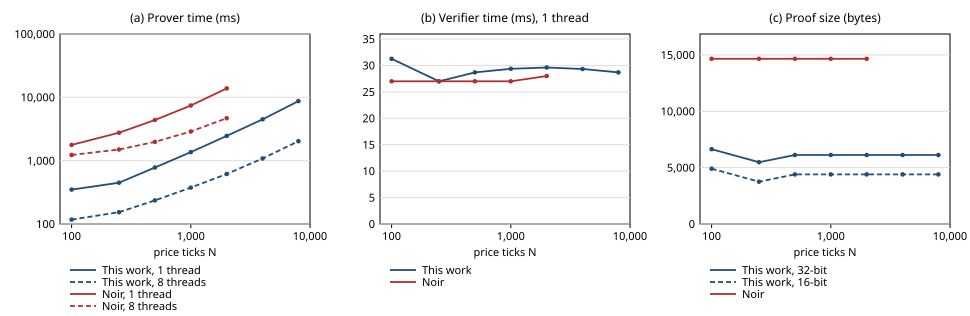

# 5 Implementation and Performance

## 5.1 Prototype

We implement the prover and verifier in Rust using arkworks [2], hiding KZG10 commitments over BN254, and a SHA-256 transcript. Three library crates contain 3,587 lines for shared types, commitments, and the protocol. The prover and verifier call the same constraint function. The prover evaluates it on four cosets of $H$ to construct the quotient using domain-sized transforms. The verifier evaluates it at the challenge point. We commit in the Lagrange basis because the witness is already in evaluation form. We import a public powers-of-tau reference string [39] and verify off chain.

We implement the clearing statement independently in 208 lines of Noir [5] and prove it with Barretenberg’s UltraHonk [4]. The private input is the book and a salt. The circuit publishes a salted Poseidon2 digest [25] and the clearing receipt. An unconstrained function proposes the receipt. The circuit checks its values against the rule in Section 3.5, using integer types for range checks.

## 5.2 Setup

We benchmark both implementations on mains power on an AMD Ryzen 3 7320U laptop with four cores, eight hardware threads, and 13.8 GB of memory. Rust runs natively on Windows 11 and Noir under WSL2. We report medians over 20 Rust runs and 10 Noir runs, using either one or eight threads. Input volumes are 32 bits unless specified. We use four sets of books.

- **Uniform books**, generated by the benchmark tool, from 100 to 8,000 ticks. We use them for scaling and for the order stream of the update-validity proof.
- **Calibrated books**, 25 books of 100 to 2,000 ticks from a generator fitted to real order flow (Section 5.6).
- **Real books**, 32 batches of Nasdaq order flow for AAPL, each a window of 601 to 662 ticks (Section 5.6).
- **Outcome books**, 362 books of 101 ticks built from the published outcomes of a deployed periodic auction (Section 5.7).

## 5.3 One Batch

**Table 3.** One batch, $N = 1000$, 32-bit volumes, 250 orders, single core. Verification includes decoding the proof. The clearing proof is measured on the calibrated books and the other two on uniform books with a generated order stream.

| | Clearing proof | Update-validity proof | No-cross proof |
|---|---|---|---|
| Proof generation | 1.34 s | 0.42 s | 0.40 s |
| Commitments | 89 | 17 | 20 |
| Opening points | 2 | 2 | 2 |
| Proof size | 6,124 B | 1,700 B | 1,612 B |
| Verification | 29 ms | 48 ms | 12 ms |

A crossing batch requires the clearing and update-validity proofs. Together they occupy 7,824 bytes and contain 106 commitments. Generating both takes about 1.8 s on one core and 0.50 s on eight threads. On one core the full batch check takes 79 ms. Decoding 89 compressed curve points accounts for about two thirds of clearing-proof verification time. The remaining check takes 10 ms.

Recording an order takes 0.98 ms and adds 416 bytes to the public log. A trader checks the receipt in 0.24 ms. Once the book closes, the plaintext clearing calculation takes 0.07 ms.

The 32 replayed books span 601 to 662 ticks, all of which round up to a 1,024-row domain. Their clearing proofs take 1.35 s on one core and 0.37 s on eight threads, close to the times for the 1,000-tick synthetic books.

## 5.4 Scaling

**Figure 3.** The clearing proof against the number of price ticks, for this work and for the Noir circuit. (a) Prover time; the circuit's time includes witness generation. (b) Verifier time on one thread. (c) Proof size.

Increasing a uniform book from 1,000 to 8,000 ticks raises clearing-proof generation time from 1.37 to 8.7 s on one core and from 0.38 to 2.0 s on eight threads (Figure 3a). Across the tested books with at least 500 ticks, the 16-bit proof has 62 commitments and occupies 4,396 bytes. The 32-bit proof has 89 commitments and occupies 6,124 bytes. Verification times vary little across this range (Figures 3b and 3c). Smaller domains use different limb layouts (Appendix G).

At 1,000 price ticks, the cost of update validity increases with the number of logged orders (Table 4). Each order adds four rows, and the verifier combines every logged step. At 1,000 orders the update-validity prover takes about as long as the clearing prover. Its proof occupies 1,700 bytes at all three tested log lengths.

**Table 4.** The update-validity proof against the number of orders in the batch, $N = 1000$, eight threads. The last column is the time to generate both proofs.

| Orders | Domain $M$ | Prove | Verify | Both proofs |
|---|---|---|---|---|
| 250 | 1,024 | 122 ms | 23 ms | 0.50 s |
| 1,000 | 4,096 | 347 ms | 43 ms | 0.73 s |
| 2,200 | 16,384 | 1,083 ms | 69 ms | 1.46 s |

At 1,000 ticks, proof generation fits within a one-second interval for the 1,000-order benchmark (0.73 s). It takes 1.46 s at 2,200 orders. Even the 250-order case exceeds a 100 ms interval. These are measurements of proving after the batch closes.

## 5.5 Comparison with a General-Purpose Proof System

The independent implementations return identical receipts on all 32 replayed books and 25 calibrated books. Table 5 compares the cost of proving the clearing statement at 1,000 ticks.

**Table 5.** The clearing proof, $N = 1000$, 32-bit volumes, single core.

| | This work | Noir with UltraHonk |
|---|---|---|
| Size of the statement | 88 columns, 1,024 rows | 100,357 gates |
| Proof generation | 1.34 s | 7.43 s (1.00 s witness, 6.43 s proof) |
| Proof size | 6,124 B | 14,656 B |
| Verification | 29 ms | 27 ms |
| Prover memory (peak, whole process) | 19 MB | 157 MB |
| Lines of code | 3,587 | 208 |

On one thread, the Noir implementation takes 5.5 times as long to generate a clearing proof at 1,000 ticks, including witness generation. Its proof occupies 2.4 times as many bytes. Verification takes 27 ms for Noir and 29 ms for Rust. Across the calibrated book sizes, the one-thread timing ratio ranges from 5.2 to 6.7 (Appendix G). At 1,000 ticks it reaches 7.7 on eight threads, where Noir witness generation remains sequential. On the replayed books the one-thread ratio falls to 3.8. The Rust prover pads those books to 1,024 rows, while the circuit size follows the tick count. The circuit uses about 100 gates per tick, roughly a quarter for the digest. The ratios include command startup for Noir, while the Rust benchmarks time function calls.

The 208-line Noir circuit uses a maintained prover and binds the finished book to a digest. The Rust library also maintains commitments as orders arrive, issues trader receipts, and proves the validity of the update log. Those operations lie outside the clearing comparison in Table 5.

## 5.6 Order Flow

For order-level analysis we replay Nasdaq TotalView-ITCH messages for AAPL [36]. We divide each regular session into consecutive intervals and clear a book built from resting depth and executed volume on each side. We select four trading days in 2026 using the event and market-condition screens in Appendix F. This replay lets us examine the losing orders that the Cboe auction summaries omit.

Among crossing one-second batches, an average of 3.6% have several volume-maximizing ticks (95% interval across days, 1.5% to 5.7%). In 0.3%, more than one tick also minimizes imbalance, or roughly 40 batches per day for AAPL. Of the four durations tested, one second has the highest plateau frequency. At one minute it falls to 0.7% (Table 6).

**Table 6.** Tie frequency in replayed AAPL order flow, as a percentage of crossing batches; mean over four days, standard deviation across days in parentheses.

| Batch length | Crossing batches per day | One maximizing tick | Plateau, one minimum-imbalance tick | Plateau, several |
|---|---|---|---|---|
| 0.1 s | 23,131 | 97.90 (0.59) | 1.78 (0.40) | 0.33 (0.29) |
| 1 s | 13,386 | 96.37 (1.32) | 3.31 (1.05) | 0.32 (0.31) |
| 10 s | 2,331 | 97.15 (0.78) | 2.79 (0.70) | 0.06 (0.08) |
| 60 s | 390 | 99.29 (0.13) | 0.71 (0.13) | 0.00 (0.00) |

Muni Toke derives the distribution of the clearing-price range in a model [35]. We are unaware of an empirical estimate for these ties based on the hidden books of exchange auctions.

Independent draws from the depth distribution at each tick produce a plateau in 14.6% of one-second synthetic batches. The pooled replay frequency is 3.8%. Resampling a replayed book’s volumes jointly within 10 ticks of its clearing price and calibrating the outer ticks from the observed marginals brings the synthetic frequency to 4.1%. We also retain 32 replayed books with plateaus 2 to 35 ticks wide. Twelve have a further tie on imbalance.

**Scope.** The replay measures how our rule clears observed continuous-market order flow for one liquid stock on four analysis days. Traders in an FBA could submit different orders. The feed contains no IO orders, so we exercise that part of the rule in unit tests. All timings are from one laptop.

## 5.7 A Deployed Periodic Auction

We use Cboe Europe’s BXE data to examine trading in an operating FBA and to test our Rust and Noir implementations at prices and volumes observed in that market. Zhang and Ibikunle describe Cboe’s sub-second periodic auction and its price-setting and allocation rules [46, Section 3.2]. For Orange SA on 1 September 2020, the BXE feed [15] reports indicative prices and sizes, final prices and sizes, and individual executions. The underlying auction orders, including those that did not execute, stay private. A participant can observe the outcome but lacks the book needed to recompute it.

The 362 auctions traded 238,921 shares, with a median of 434 shares per auction. Of these auctions, 327 had one execution, 32 had two, and three had three. In 320 cases at most 100 ms elapsed between the first indicative update and execution. The median interval between auctions was 44 s (Appendix F.6). These counts describe executions. The number of submitted orders is unobserved.

For each published outcome we construct a 101-tick book on a EUR 0.001 grid centred on the reported price. We place the executed volume on both sides at the centre and leave all other ticks empty. Both implementations produce verifiable proofs for all 362 constructed books, and the price and volume fields agree with the feed in every case. At the corresponding domain size, the Rust benchmark gives a 6,636-byte proof and proving times of 0.35 s on one core and 0.12 s on eight threads (Appendix G). Verifying how BXE matched the actual orders would require evidence about its private book.
